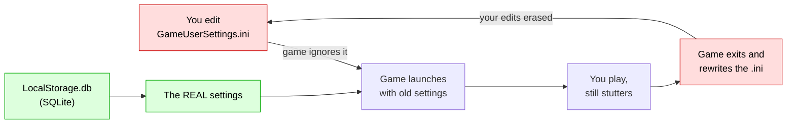
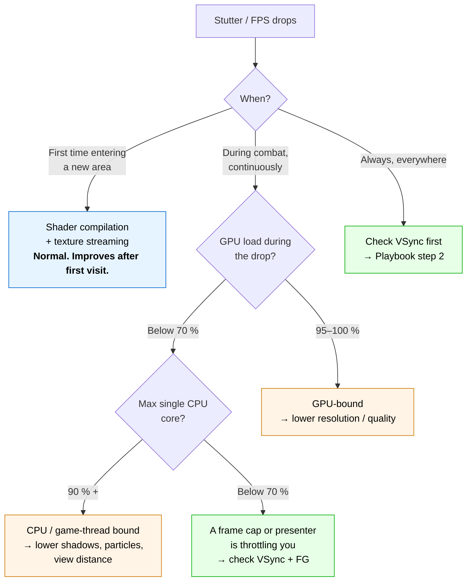

<div align="center">

# 🎮 Wuthering Waves — The Stutter Bible

**Every FPS drop, explained. Every fix, measured. No guessing.**

[](https://www.microsoft.com/windows)
[](#test-machine)
[](#-myth-1-frame-generation-is-free-performance)
[](#-tools)
[](LICENSE)

*A complete, evidence-based teardown of Wuthering Waves stutter on gaming laptops —
built from a real 3-hour debugging session, with telemetry to back every claim.*

</div>

---

## 🚀 The 3-minute fix

If you only read one thing, read this.

| Setting | Value | Where |
|---|---|---|
| **Vertical Sync** | **OFF** | in-game → Graphics |
| **Frame Generation** | **OFF** | in-game → Graphics → DLSS |
| **FPS Limit** | **120** | in-game → Graphics *(unlocks only when FG is OFF)* |
| **DLSS Super Resolution** | **ON** | in-game → Graphics |
| **Display Mode** | Borderless *(or Fullscreen — not Windowed)* | in-game |
| **Windows Game Mode** | **ON** | Settings → Gaming |

Then **restart the game** and play. That's it.

> ⚠️ **Do not click "Recommended Settings".** It silently turns Frame Generation back on and re-locks your FPS option.

---

## 🤔 Why the obvious advice fails

You've probably already tried the usual list: update your driver, cap your FPS, lower your settings, check your temperatures. None of it worked — because **Wuthering Waves does not store its graphics settings where you think it does.**



**`GameUserSettings.ini` is a decoy.** The game reads and writes it, so it looks authoritative — but the values that actually control VSync and the frame cap live in a **SQLite database** called `LocalStorage.db`. Editing the `.ini` is a no-op: the game overwrites it on exit.

This repository documents that database, the keys that matter, and how to prove the fix on your own machine with a 2-second-interval telemetry logger.

---

## 📖 Table of contents

| Document | What's inside |
|---|---|
| 📘 **[docs/01-playbook.md](docs/01-playbook.md)** | The step-by-step diagnosis. Check these in this order — stop as soon as you find your problem. |
| 📗 **[docs/02-settings-reference.md](docs/02-settings-reference.md)** | Every graphics key explained: what it does, valid values, what we know and what we don't. |
| 📙 **[docs/03-measurements.md](docs/03-measurements.md)** | The raw numbers. GPU load, temperatures, power, CPU threads — before and after. |
| 📕 **[docs/04-troubleshooting.md](docs/04-troubleshooting.md)** | Symptom → cause → fix matrix, plus the weird edge cases. |
| 🛠 **[tools/](tools/)** | Ready-to-run PowerShell + Python scripts: telemetry, analysis, settings reader. |

---

## 🔬 What was actually wrong

Three separate problems were stacked on top of each other. Each one alone would cause stutter; together they made the game feel broken.

### Problem 1 — VSync turned every small dip into a cliff

The game was running **VSync ON with a 60 FPS cap** on a **360 Hz** panel.

```
Frame budget at 60 FPS = 16.7 ms
Frame arrives at        = 17.2 ms  (0.5 ms late)
VSync discards it       → next frame shown 33.4 ms later
Result                  = 60 → 30 → 60 → 30 …
```

In combat, frames are heavier. Almost every frame arrives slightly late. So the game oscillates between 60 and 30 FPS **for the entire fight** — exactly the "continuously drops during combat" symptom.

**Fix:** VSync OFF. Without it, a late frame is just a late frame. No cliff.

### Problem 2 — Frame Generation was capping the game at 60

Frame Generation (FG) *doubles* frames. It does **not** make them arrive sooner:

| | Frame Generation ON | Frame Generation OFF |
|---|---|---|
| Frames rendered per second | 60 | 120 |
| Time per real frame | **16.7 ms** | **8.3 ms** |
| Frames shown per second | 120 *(half fake)* | 120 *(all real)* |
| Input latency | high | **low** |

Both say "120 FPS". Only one feels smooth. That's why **FG OFF + 120 native beat FG ON + 120 generated** in our A/B test — see [measurements](docs/03-measurements.md#the-ab-test).

And here's the trap: **while FG is ON, the game greys out the FPS Limit control.** You cannot set 120. The game decides for you.

### Problem 3 — The settings were being silently reverted

Every `.ini` edit was overwritten at exit. The real values lived in `LocalStorage.db`:

```sql
-- before
PcVsync              = 1     -- VSync ON
CustomFrameRate      = 2     -- 60 FPS cap
NvidiaSuperSamplingFrameGenerate = 1   -- FG ON
```

**Fix:** write to the database, not the ini. Instructions in the [playbook](docs/01-playbook.md#step-4--fix-the-real-settings-database).

---

## 🧊 Myth-busting

Every one of these was tested on the machine. Numbers in [docs/03-measurements.md](docs/03-measurements.md).

| Myth | Reality |
|---|---|
| 🧊 *"It's thermal throttling — my laptop is too hot."* | **Never exceeded 72.9 °C.** The 85 °C cap was never touched. Zero samples at or above 85 °C across 330 gameplay samples. |
| ⚡ *"The GPU is maxed out."* | GPU averaged **54–64 % load** and peaked at **97 W of a 140 W budget**. Nearly 45 W sat unused. |
| 🎮 *"Frame Generation gives free performance."* | FG adds *presented* frames, not *responsiveness*. At a 60 FPS base it feels worse than native 120. **Measured and confirmed.** |
| 🚨 *"The game says 'Laggy' next to 120 FPS, so 120 must be bad."* | That badge is a **static heuristic** based on your GPU model — not a measurement. It was wrong. |
| 🔧 *"Editing GameUserSettings.ini works."* | The game rewrites it on exit. Your edit survives until you press Quit. |
| 💥 *"Those WHEA PCIe errors in Event Viewer are the problem."* | 142 *corrected* errors over 10 days on the dGPU's PCIe link — normal noise on Optimus laptops, corrected by hardware. Not the cause. |
| 🌡️ *"Raising the thermal limit to 100 °C will help."* | The limit never engaged at 85 °C. Changing it does nothing except make you feel worse. |

---

## 🧭 Which symptom is yours?



---

## 🧰 Tools

All scripts are **read-mostly**, take backups before writing, and print what they changed.

| Script | What it does |
|---|---|
| [`tools/read-game-settings.ps1`](tools/read-game-settings.ps1) | Prints every graphics setting from `LocalStorage.db`. Read-only. |
| [`tools/wu-telemetry.ps1`](tools/wu-telemetry.ps1) | Logs GPU temp / clock / power / load + per-core CPU + game CPU every ~2 s. |
| [`tools/analyze-telemetry.py`](tools/analyze-telemetry.py) | Turns that CSV into a verdict: GPU-bound, CPU-bound, capped, or thermal. |

Quick start:

```powershell
# 1. see what your game is really set to
powershell -ExecutionPolicy Bypass -File .\tools\read-game-settings.ps1

# 2. start logging, then go play for 10 minutes
powershell -ExecutionPolicy Bypass -File .\tools\wu-telemetry.ps1

# 3. read the verdict
python .\tools\analyze-telemetry.py .\wu-telemetry.csv
```

---

## 🛟 Safety & rollback

Everything in this guide is reversible.

- Both the `.ini` and the `.db` are **backed up** with a timestamp before any change.
- To roll back: copy the `.bak-YYYYMMDD-HHMMSS` file back over the original.
- Close the game before touching either file — the game holds the database open while running.
- No driver changes. No registry hacks. No overclocking. No modified game files.

> **Never** edit these files while the game is running. The game caches them in memory and will overwrite your changes on exit.

---

## 🖥 Test machine

| | |
|---|---|
| Laptop | Dell G15 5530 |
| CPU | Intel Core i7-13650HX (14C / 20T) |
| GPU | NVIDIA RTX 4060 Laptop, 8 GB — driver 32.0.16.2101 |
| iGPU | Intel UHD Graphics — 32.0.101.7088 |
| Display | 1920 × 1080 @ 360 Hz, internal eDP |
| RAM | 16 GB DDR5-5600 |
| OS | Windows 11 Pro, build 26300 |
| Game | Wuthering Waves (UE4), `D:\Games\Wuthering Waves` |

---

## 🤝 Contributing

Found a key we missed? A different GPU behaves differently? Open an issue with:

1. Your `read-game-settings.ps1` output
2. A telemetry CSV from a 5-minute session
3. What the game felt like

Numbers beat opinions.

---

<div align="center">

**MIT Licensed** · Built by debugging, not by guessing.

⭐ If this saved you an evening, star the repo — it helps the next person find it.

</div>
