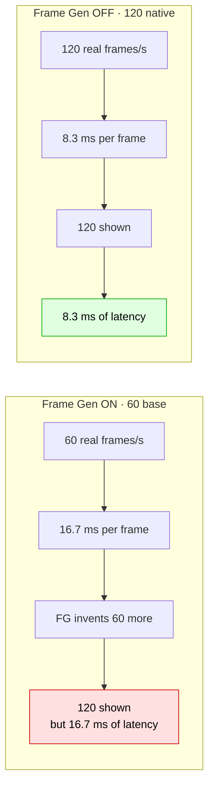

# 📙 Measurements

> Every claim in this repository is backed by a number from a real session.
> If you disagree with a conclusion, check the data first.

---

## Method

| | |
|---|---|
| Logger | [`tools/wu-telemetry.ps1`](../tools/wu-telemetry.ps1) |
| Sample interval | ~2 s (GPU) / ~3 s (CPU counters) |
| GPU metrics | `nvidia-smi` — temperature, clock, power, utilisation |
| CPU metrics | `\Processor Information(*)` performance counters — total load, **max single core**, game process CPU |
| Sessions | 2 · 330 gameplay samples total |
| Machine | Dell G15 5530 · i7-13650HX · RTX 4060 Laptop (140 W) · 1080p **360 Hz** |

Two independent runs, on two different days of tuning, with the same tooling.

---

## Session 1 — baseline (VSync already off, Frame Gen ON)

199 samples · 14:49:59 → 14:59:49

| Metric | Value |
|---|---|
| GPU utilisation | mean **54.1 %** · median 63 % · p90 87 % · max 93 % |
| Samples ≥ 90 % | **4.7 %** |
| Samples < 70 % | **54.4 %** |
| GPU temperature | mean 63.9 °C · **max 71.8 °C** |
| Samples ≥ 85 °C | **0** |
| GPU power | mean 56.6 W · max **94.7 W** (limit 140 W) |
| GPU clock | mean 2497 MHz · min 1350 · max 2625 |
| CPU frequency | mean 3692 MHz · **min 2603 MHz** (never below base) |

### The signature of a frame cap

Minute-by-minute GPU utilisation:

```
14:50   12.8 %   ← one full minute at 12 %
14:51   35.5 %
14:52   58.8 %
14:53   85.2 %
14:54   76.8 %
14:55   49.0 %
```

**A GPU that sits at 12.8 % for a whole minute in a 3D game is not being asked to work.** An uncapped RTX 4060 at 720p would be pinned near 99 %. That gap is the cap.

> 📌 54 % average load and 94.7 W of 140 W means **~45 W of the GPU's power budget went unused** for the entire session.

---

## The A/B test

Same session, same scene, same machine. Only the switch changed:

| | **A — Frame Gen ON** | **B — Frame Gen OFF + 120 cap** |
|---|---|---|
| Window | 15:08 → 15:13 | 15:13 → 15:17 |
| Samples | 67 | 70 |
| GPU utilisation (mean) | 56.0 % | **63.8 %** |
| GPU utilisation (max) | 95 % | **99 %** |
| Samples ≥ 90 % | 17.9 % | 20.0 % |
| GPU power (mean / max) | 61.6 / 96.1 W | 61.3 / **97.1 W** |
| GPU temp (mean / max) | 63.1 / 71.7 °C | 66.7 / **72.9 °C** |
| GPU clock (mean / min) | 2524 / 2370 MHz | 2454 / 1110 MHz |
| CPU total (mean) | 26.2 % | 28.2 % |
| **Max single CPU core** | **95.3 %** | 90.8 % |
| Game CPU (mean, cores) | 17.1 | 18.8 |

### Verdict

The GPU did **more work** and stayed **just as cool** in B, and the user's own verdict was:

> *"FG OFF + 120 = butter smooth. FG ON = stuttery."*

Why both can say "120 FPS" and feel completely different:



**Frame Generation buys frames, not time.** At a 60 FPS base, each real frame is still 16.7 ms old. That is what your hands feel.

---

## What was **ruled out**

### ❌ Thermal throttling

| Evidence | Value |
|---|---|
| Highest GPU temperature across all 330 gameplay samples | **72.9 °C** |
| The user's configured thermal limit | 85 °C |
| Samples at or above 85 °C | **0** |
| HW thermal slowdown flag | never active |

The thermal cap never engaged. Raising or lowering it changes nothing.

### ❌ GPU power limit

Peak draw was **97.1 W** against a **140 W** ceiling. The GPU was never power-starved.

### ❌ CPU throttling

`\Processor Information(_Total)\% Processor Performance` never dropped below **100 %** — the CPU never clocked below its 2.6 GHz base, and averaged 3.7 GHz.

### ❌ WHEA hardware errors

Windows logged **142 corrected PCIe errors** over 10 days, all on the dGPU's link (`PCI\VEN_10DE&DEV_28E0`):

```
Component: PCI Express Legacy Endpoint
Error Source: Advanced Error Reporting (PCI Express)
```

All **corrected** — the hardware fixed them itself. This is ordinary behaviour on Optimus laptops where the dGPU link enters and leaves low-power states. It correlates with session start/stop, not with frame drops.

### ❌ Driver version

Tested on `32.0.16.2101`. The problems reproduced identically on the previous driver. Not a driver regression.

### ⚠️ nvidia-smi throttle counters — don't trust them here

`nvidia-smi -q -d PERFORMANCE` reported:

```
SW Power Capping     : 444146568 us
SW Thermal Slowdown  : 444022148 us
```

…after **15 minutes of uptime**. 444 seconds of throttling cannot fit in 15 minutes of idle at 50 °C. The two counters are also suspiciously identical (0.1 s apart), which suggests a platform quirk rather than real events. **Treat them as noise; use the temperature and utilisation series instead.**

---

## Repairing the record

Two values on the test machine were also corrupted and worth checking on yours:

```powershell
# should equal your DPI: 96 at 100 %, 120 at 125 %
Get-ItemProperty 'HKCU:\Control Panel\Desktop' -Name LogPixels

# default is 1200; 0 makes ClearType text look washed out
Get-ItemProperty 'HKCU:\Control Panel\Desktop' -Name FontSmoothingGamma
```

| Value | Found | Should be |
|---|---|---|
| `LogPixels` | `480` | `96` |
| `FontSmoothingGamma` | `0` | `1200` |

Not performance-related, but they make everything look soft.

---

## How to reproduce all of this yourself

```powershell
# terminal 1
powershell -ExecutionPolicy Bypass -File .\tools\wu-telemetry.ps1

# play 10 minutes, at least 3 fights

# terminal 2, after you quit
python .\tools\analyze-telemetry.py .\wu-telemetry.csv
```

The analyzer reproduces every table on this page from your own machine.

---

**Next:** [troubleshooting →](04-troubleshooting.md)
